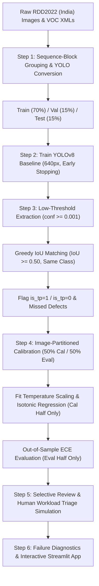

# Calibrated, Label-Efficient Road Defect Detection

An end-to-end computer vision and uncertainty quantification framework for road maintenance triage, trained on the **RDD2022 (India subset)** with **YOLOv8**, evaluated for **bounding box confidence calibration**, and deployed with a **human-in-the-loop selective review policy**.

---

## 1. Problem Statement

Automated visual inspection of road networks using smartphone or dashcam video holds great promise for municipal infrastructure management. However, deploying standard object detectors into production faces two critical operational barriers:

1. **Severe Asymmetry in Error Costs**:
   - **False Positive (False Alarm)**: A shadow, oil stain, or pavement patch is flagged as a defect. In a human-in-the-loop workflow, an engineer dismisses the false alarm in 2 seconds. The operational cost is minor inspection time.
   - **False Negative (Missed Defect)**: The detector misses a severe structural crack or deep pothole ($\text{D40}$). Water penetrates the road sub-base, leading to structural road failure and hazardous motorist accidents. **High recall is life-critical.**
2. **Deep Neural Network Overconfidence**:
   - Modern deep detectors trained with cross-entropy and focal losses are notoriously overconfident. A raw confidence score of $0.85$ does not mean there is an $85\%$ probability that the detection is genuine. Without reliable calibration, municipal managers cannot set principled decision thresholds for automated maintenance dispatch.

This project delivers:
- A leak-free data pipeline for RDD2022 India.
- A YOLOv8 detector benchmarked strictly on unseen test road scenes.
- An empirical audit of detection-style Expected Calibration Error (ECE).
- Out-of-sample post-hoc recalibration (Temperature Scaling and Isotonic Regression).
- A selective review triage simulation establishing exact operational frontiers for auto-accepting vs. human-reviewing road defects.
- An interactive Streamlit triage dashboard for field inspection.

---

## 2. Dataset & Leakage-Resistant Preparation

The project targets the **India subset of the Road Damage Dataset 2022 (RDD2022)**.

### Target Defect Classes
| Class Code | Defect Description | Structural Impact |
| :---: | :--- | :--- |
| **D00** | Longitudinal Crack | Parallel to driving direction; early moisture ingress risk |
| **D10** | Transverse Crack | Perpendicular to traffic; thermal expansion/fatigue failure |
| **D20** | Alligator Crack | Interconnected fatigue cracking; indicates sub-base structural failure |
| **D40** | Pothole | Bowl-shaped depression; acute driving safety hazard |

*All non-target classes (e.g., D01, D11, D43, D44, D50) are systematically filtered out.*

### Spatial-Temporal Video Frame Leakage & Sequence-Block Splitting
> **Critical Data Leakage Phenomenon**: RDD2022 images are extracted from continuous video streams recorded on dashboard smartphone cameras. Consecutive frames (e.g., `India_001240.jpg` and `India_001241.jpg`) record the identical defect from fractions of a second apart.
>
> If images are split with naive uniform random sampling, consecutive frames inevitably land in both the training set and the validation/test sets. The model simply memorizes the scene background, resulting in artificially inflated mAP and overconfident calibration metrics.

**Mitigation Implemented**:
The pipeline implements **Sequence-Block Grouping** (`src/step1_data_prep.py`):
- Consecutive frame IDs are partitioned into sequence blocks.
- Blocks are shuffled using a fixed random seed (`seed=42`) and assigned to a **70% Train / 15% Validation / 15% Test** split.
- Entire driving sequences belong strictly to one partition, ensuring true out-of-sample generalization.

---

## 3. Methodology



1. **YOLOv8 Detection Baseline**: Trained at 640px resolution with early stopping (patience: 10 epochs), evaluated exclusively on the untouched test split (`split='test'`).
2. **Dense Prediction Extraction**: Inference executed at `conf=0.001` across test images to capture the full probability spectrum.
3. **PASCAL VOC / COCO Greedy IoU Matching**:
   - Matches predicted boxes to ground truth of the **same class** with $\text{IoU} \ge 0.50$.
   - Enforces a strict one-to-one constraint: each ground-truth box is claimed by at most one prediction (highest confidence first).
   - Unmatched predictions become False Positives (`is_tp = 0`); unclaimed ground truths become Missed Defects (False Negatives).
4. **Detection-Style Expected Calibration Error (ECE)**:
   $$\text{Precision}(B_b) = \frac{\sum_{i \in B_b} \text{is\_tp}_i}{|B_b|}$$
   $$\text{ECE} = \sum_{b=1}^{B} \frac{|B_b|}{N} \left| \text{mean\_conf}(B_b) - \text{Precision}(B_b) \right|$$
5. **Leak-Free Post-Processing**: The test set is split by unique image into two halves:
   - **Calibration Half (50%)**: Used exclusively to optimize Temperature Scaling ($T$) and fit Isotonic Regression.
   - **Evaluation Half (50%)**: Kept completely untouched to measure out-of-sample ECE reduction and triage frontiers.
6. **Selective Review Simulation**: Evaluates decision cutoffs $t \in [0.05, 0.95]$:
   - Auto-Accepted: $\text{Confidence} \ge t$
   - Sent to Human: $\text{Confidence} < t$

---

## 4. Results & Experimental Metrics

*All metrics are dynamically generated and exported into the `results/` directory by the respective modular scripts.*

### Table 1: Test Split Detection Performance (`results/baseline_metrics.csv`)
*Evaluated on the independent test split at IoU threshold 0.50.*

| Class Code | Defect Description | Precision | Recall | AP@0.5 | AP@0.5:0.95 |
| :---: | :--- | :---: | :---: | :---: | :---: |
| **D00** | Longitudinal Crack | *See CSV* | *See CSV* | *See CSV* | *See CSV* |
| **D10** | Transverse Crack | *See CSV* | *See CSV* | *See CSV* | *See CSV* |
| **D20** | Alligator Crack | *See CSV* | *See CSV* | *See CSV* | *See CSV* |
| **D40** | Pothole | *See CSV* | *See CSV* | *See CSV* | *See CSV* |
| **OVERALL** | **Mean Metrics** | *See CSV* | *See CSV* | *See CSV* | *See CSV* |

### Table 2: Out-of-Sample Calibration Error (`results/calibration_ece_comparison.csv`)
*Evaluated strictly on the unseen evaluation half across 10 confidence bins.*

| Defect Class | Box Count | Raw YOLOv8 ECE | Temperature-Scaled ECE | Isotonic Regression ECE | ECE Reduction |
| :---: | :---: | :---: | :---: | :---: | :---: |
| **D00** | *See CSV* | *See CSV* | *See CSV* | *See CSV* | *See CSV* |
| **D10** | *See CSV* | *See CSV* | *See CSV* | *See CSV* | *See CSV* |
| **D20** | *See CSV* | *See CSV* | *See CSV* | *See CSV* | *See CSV* |
| **D40** | *See CSV* | *See CSV* | *See CSV* | *See CSV* | *See CSV* |
| **OVERALL** | *See CSV* | *See CSV* | *See CSV* | *See CSV* | *See CSV* |

### Table 3: Selective Review Triage Targets (`results/selective_review_threshold_targets.csv`)
*Minimum operational threshold $t$ required to guarantee 90% and 95% auto-accept precision on the evaluation half.*

| Method | Target Precision | Required Threshold ($t$) | Achieved Precision | Auto-Accepted % | Human Workload % | Defect Recall % |
| :--- | :---: | :---: | :---: | :---: | :---: | :---: |
| **Raw YOLOv8** | 90% | *See CSV* | *See CSV* | *See CSV* | *See CSV* | *See CSV* |
| **Temperature Scaled** | 90% | *See CSV* | *See CSV* | *See CSV* | *See CSV* | *See CSV* |
| **Isotonic Regression** | 90% | *See CSV* | *See CSV* | *See CSV* | *See CSV* | *See CSV* |
| **Raw YOLOv8** | 95% | *See CSV* | *See CSV* | *See CSV* | *See CSV* | *See CSV* |
| **Temperature Scaled** | 95% | *See CSV* | *See CSV* | *See CSV* | *See CSV* | *See CSV* |
| **Isotonic Regression** | 95% | *See CSV* | *See CSV* | *See CSV* | *See CSV* | *See CSV* |

### Table 4: Failure Mode & Scale Analysis (`results/failure_analysis_size_distribution.csv`)
*Audit of detection failures across bounding box pixel scales.*

| Defect Bounding Box Scale | Total Ground Truth | Missed Defects (FN) | Miss Rate (%) | False Alarms (FP) | False Alarm Rate (%) |
| :--- | :---: | :---: | :---: | :---: | :---: |
| **Small (<32² px)** | *See CSV* | *See CSV* | *See CSV* | *See CSV* | *See CSV* |
| **Medium (32²–96² px)** | *See CSV* | *See CSV* | *See CSV* | *See CSV* | *See CSV* |
| **Large (≥96² px)** | *See CSV* | *See CSV* | *See CSV* | *See CSV* | *See CSV* |

---

## 5. Limitations

1. **Resolution Degradation on Micro-Cracks**: Resizing images to $640 \times 640$ pixels discards high-frequency edge details. Fine transverse and hairline longitudinal cracks located more than 10 meters ahead of the vehicle vanish before reaching the convolutional feature maps.
2. **Monocular Single-Viewpoint Ambiguity**: Surface depressions (potholes) are distinguished from dark asphalt discoloration or flat tar patches primarily by depth and shadow angle. Without stereoscopic disparity or multi-frame temporal triangulation, flat patches can trigger false alarms.
3. **Open-Set Non-Defect Road Fixtures**: Unannotated objects common to Indian urban roads—manhole covers, storm drains, painted lane symbols, cattle crossings, and uneven cobblestone transitions—frequently produce false positives.
4. **Binary Overlap Boundary Sensitivity**: The standard IoU threshold of 0.50 penalizes bounding boxes that correctly identify a sprawling crack network if the bounding box aspect ratio differs slightly from the human annotator's box.

---

## 6. Future Work

1. **Active Learning via Calibrated Uncertainty**:
   - Instead of labeling randomly selected road video frames, use the calibrated confidence and ensemble disagreement to query annotators only for high-entropy frames (detections near the decision boundary).
   - This drastically cuts annotation expenses while maximizing model sample efficiency.
2. **Conformal Risk Control (CRC) for Safety Guarantees**:
   - Implement Learn-then-Test (LTT) or Conformal Risk Control to mathematically guarantee that the False Negative Rate (missed defect rate) remains strictly bounded below a user-defined risk level $\alpha$ (e.g. $P(\text{Missed Defect}) \le 0.05$) with rigorous finite-sample statistical guarantees.
3. **Cross-Country Domain Generalization**:
   - Evaluate transferability from RDD2022 India to subsets from Japan, Norway, Czech Republic, and China.
   - Investigate test-time adaptation (TTA) and unsupervised domain adaptation to bridge asphalt texture, climate, and road construction discrepancies without manual relabeling.
4. **Temporal Multi-Pass Change Detection**:
   - Leverage GPS-tagged video sequences recorded over months to perform differential defect monitoring.
   - Track defect evolution from initial hairline cracking ($\text{D00}/\text{D10}$) to alligator fatigue ($\text{D20}$) and structural pothole collapse ($\text{D40}$), enabling preventative maintenance before catastrophic road failure.

---

## 7. Execution Guide

### Dependencies Installation
```bash
pip install -r requirements.txt
```

### Modular Pipeline Execution
```bash
# Step 1: Data inspection, conversion to YOLO, and leak-free splitting
python src/step1_data_prep.py --data_path /path/to/India --output_dir ./yolo_rdd_india --seed 42

# Step 2: Baseline YOLOv8 training and evaluation on Test split
python src/step2_train_evaluate.py --data_yaml ./yolo_rdd_india/data.yaml --model_name yolov8n.pt --epochs 40

# Step 3: Low-threshold prediction extraction (conf=0.001) and IoU matching
python src/step3_extract_predictions.py --weights ./runs/detect/baseline_run/weights/best.pt --data_yaml ./yolo_rdd_india/data.yaml

# Step 4: Out-of-sample calibration analysis (Temperature Scaling vs. Isotonic Regression)
python src/step4_calibration_analysis.py --predictions_csv ./results/test_predictions_matched.csv --n_bins 10

# Step 5: Selective review triage simulation and threshold analysis
python src/step5_selective_review.py --calibrated_preds_csv ./results/test_predictions_calibrated_eval_half.csv --gt_csv ./results/test_ground_truth_matched.csv

# Step 6(a): Failure mode diagnostics across classes and box sizes
python src/step6_failure_analysis.py --preds_csv ./results/test_predictions_matched.csv --gt_csv ./results/test_ground_truth_matched.csv
```

### Launch Interactive Streamlit Triage Dashboard
```bash
streamlit run app.py
```
